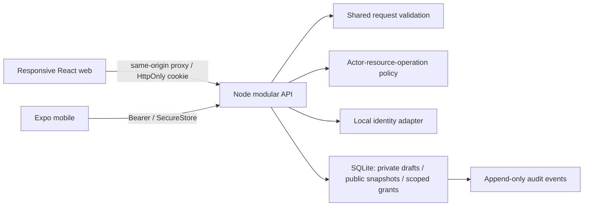

# I2V Exchange — implemented local architecture

See ADR 0001 for decisions and `GETTING_STARTED.md` for commands. Full destination specifications remain authoritative for scope; this file describes only implemented components.

`packages/domain` holds public/private types and pure policy. `packages/schemas` defines strict input validation. `packages/client` supplies common request/error handling. `packages/design` owns replaceable product labels, navigation and theme tokens. Server-only auth/persistence packages are never imported by either client. `packages/adapters` defines external-service seams and the fail-closed mode guard.

The API separates identity, roles, organizations, discovery, private workspace, evidence, access requests, watchlist, and audit routes inside one process. Extract route modules as these domains grow; there is no distributed-service dependency.

The Expo client supports real local signup, sessions, project drafts/publication, milestone entry, discovery, watchlists, profiles, role requests, organization claims, and request approval/revocation. Web additionally exposes comparison selection and private evidence-note creation. Arena and Exchange describe their actual pending implementation status and route members into real role onboarding; they are not completed event/booking modules.

The database bootstrap is additive version 1. Future schema changes must introduce versioned migrations; do not reinterpret `CREATE TABLE IF NOT EXISTS` as an upgrade strategy. Public discovery reads only `public_data` snapshots. Cache headers disable storage of API responses in this increment. There is no search, analytics or AI ingestion pipeline for private content.
