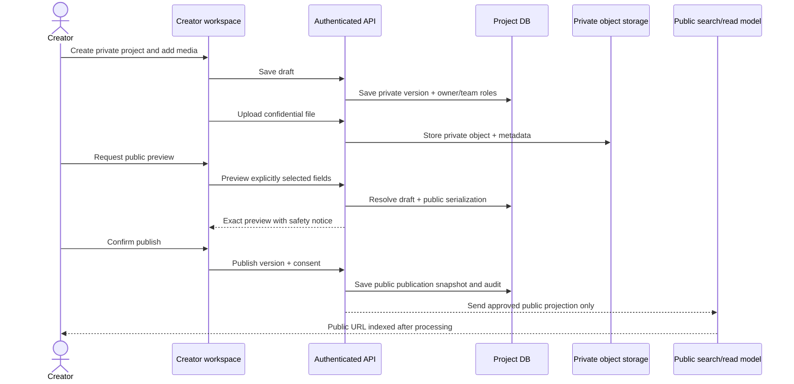
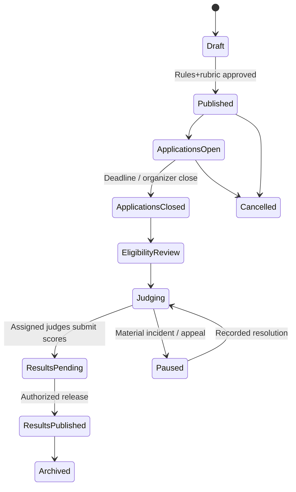
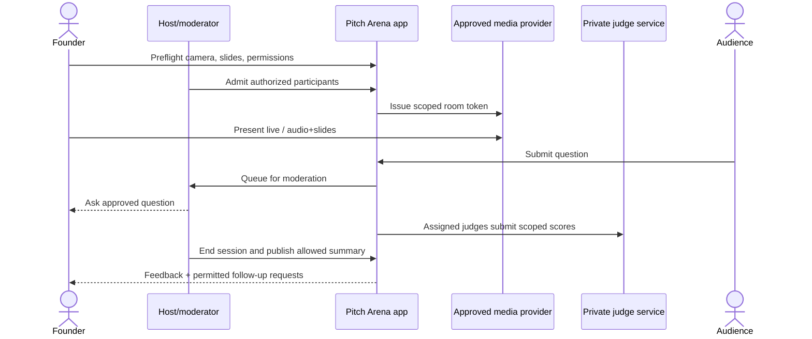
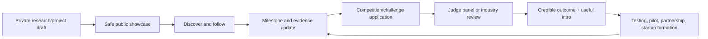

# Workflow Diagrams — First-Class Platform Journeys

These are **design sketches**; implementation requires approved data model and auth policy. Mermaid diagrams can be rendered by GitHub and some documentation tools.

## Publish a project — privacy-critical boundary

**Invariant:** uploading a technical document never publishes it merely because the synopsis becomes public. A derived thumbnail is classified independently according to source access rights.

## Competition — permanent project, fair results

**Invariant:** `project_id` and historical entry snapshots remain stable. Rubric/terms and score events are versioned; COI recusal controls must be server-side. Archive and corrections preserve evidence without publicly exposing restricted scores.

## Live pitching — controlled experience

**Invariant:** live token does not authorize private project document or replay. Recording requires its own explicit consent and resource policy.

## Public profile follows creator development

**Metric:** optimize transitions toward validated development and authorized opportunities, not click-through alone.
